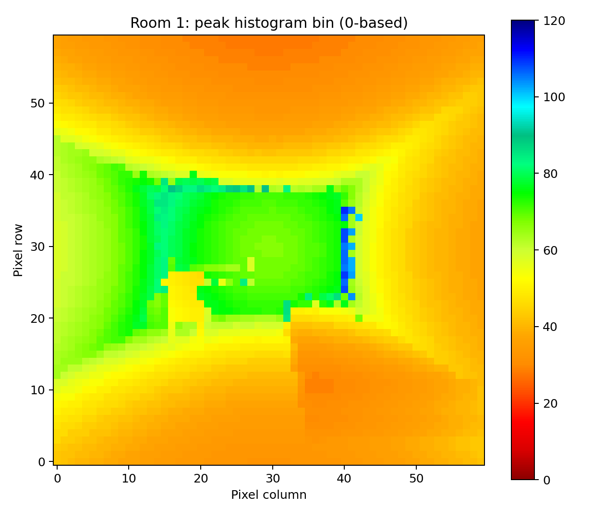
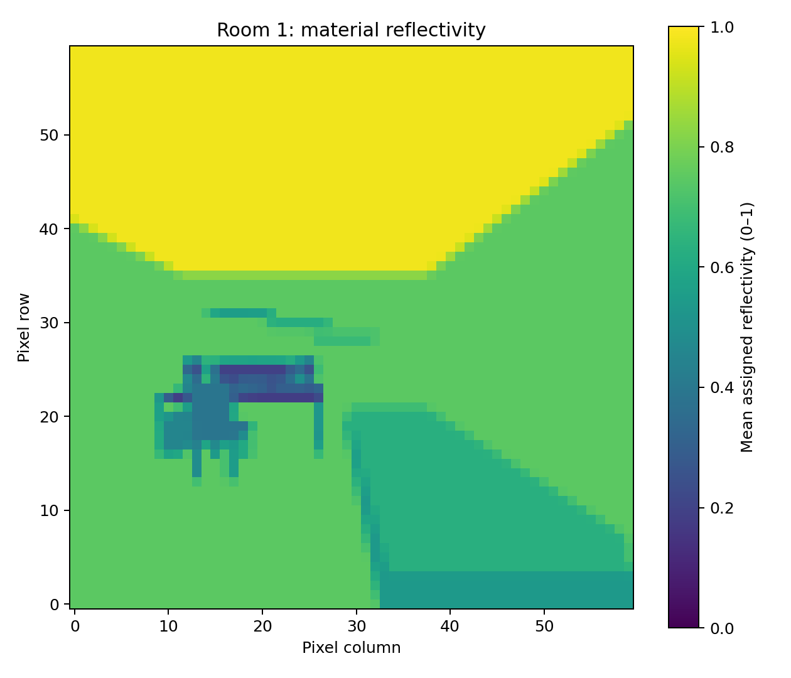
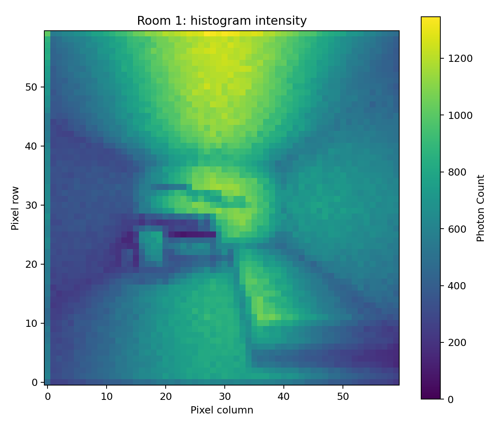
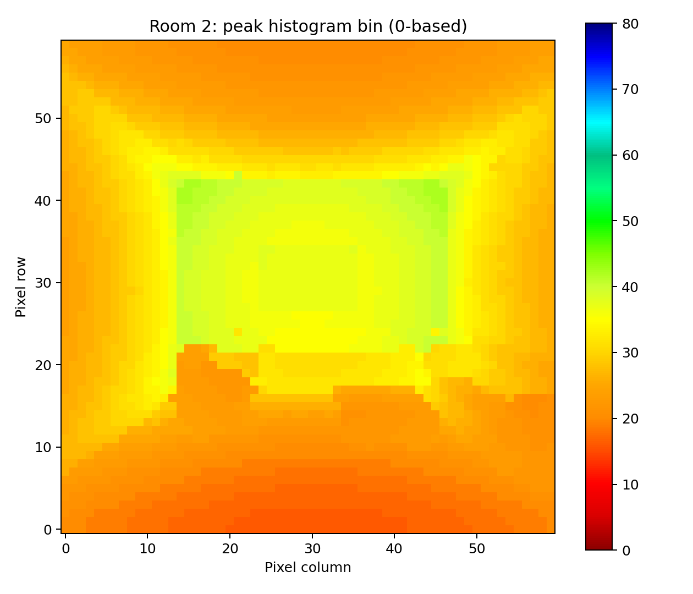
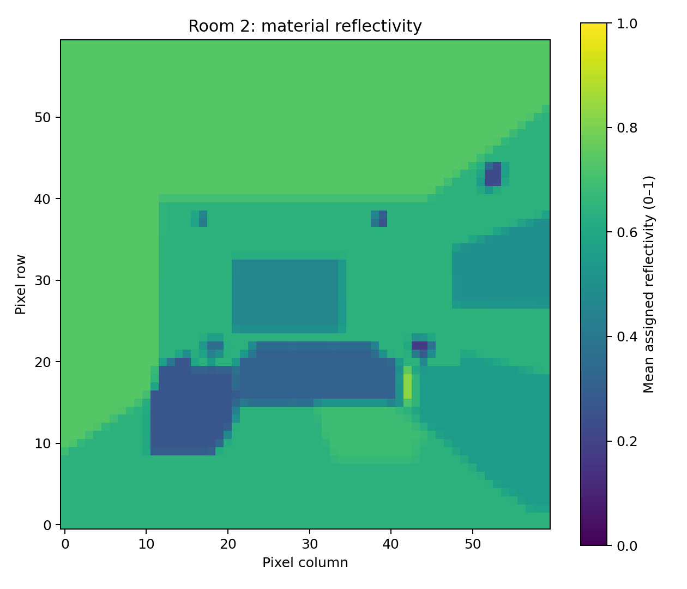
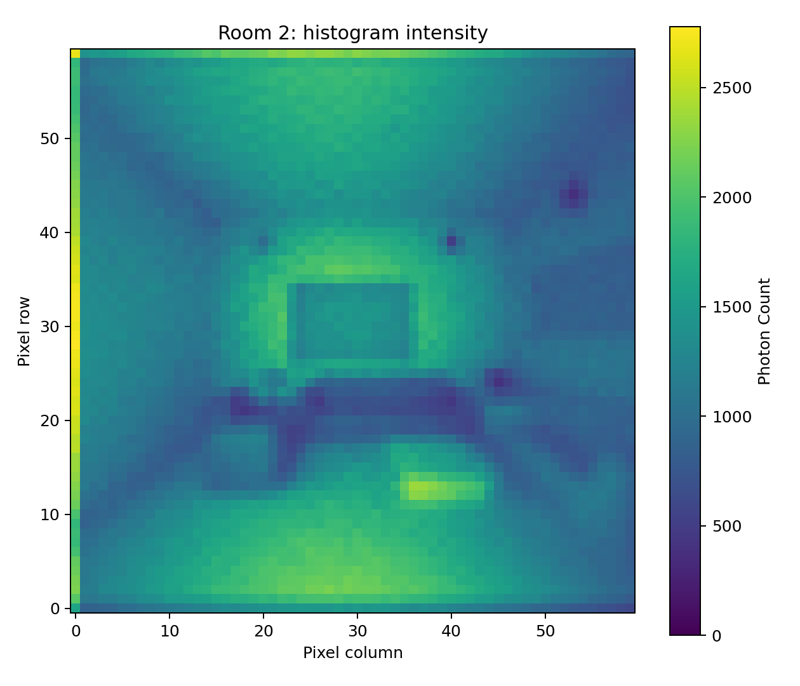
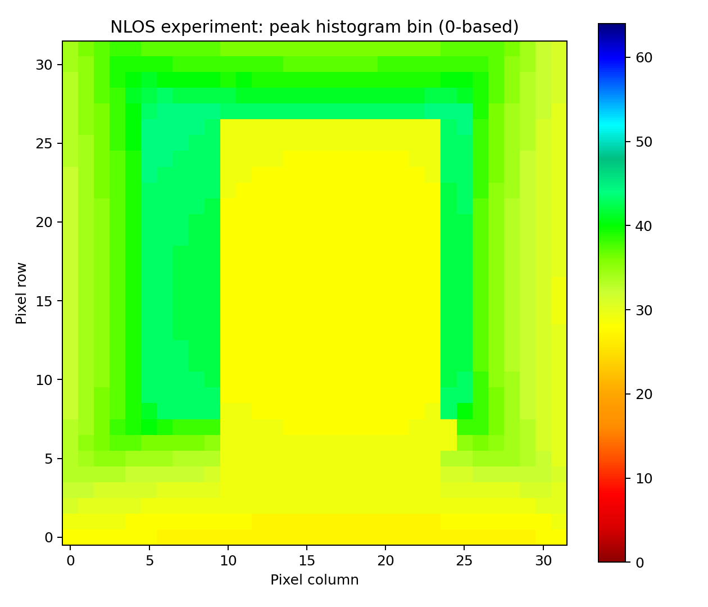
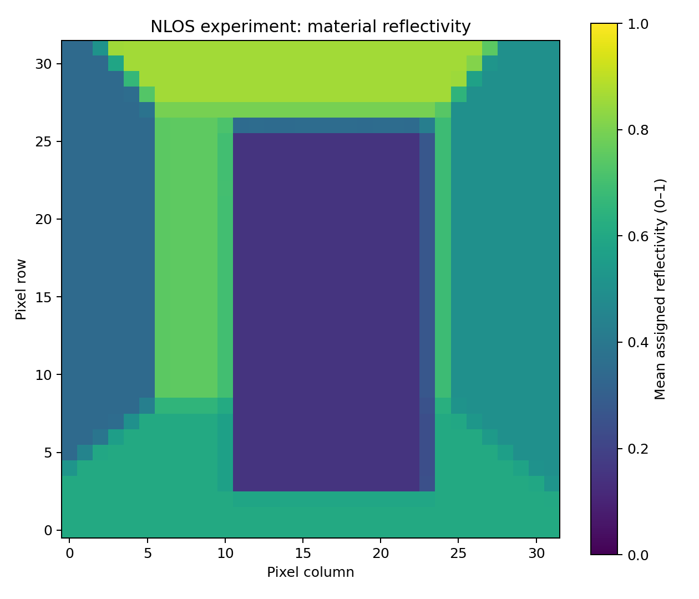
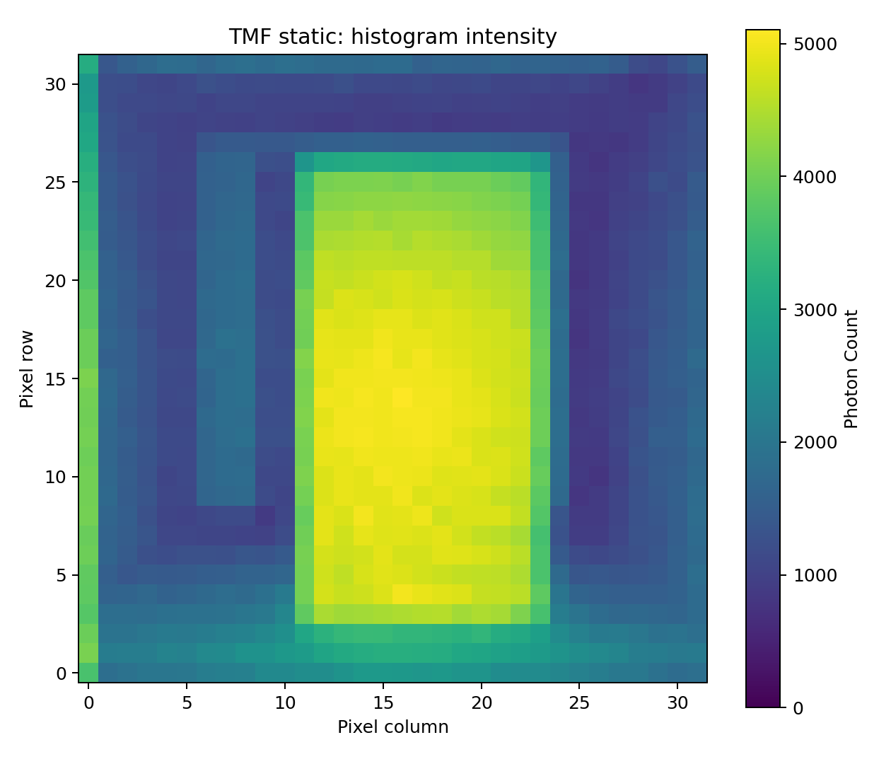

# NLOS-LiDAR

Monte Carlo LiDAR photon simulation, detector pixelization, and sensor noise generation in one repository. The simulator uses C++/SYCL, pixelization and sensor kernels use Rust, and Python provides scene generation, noise models, HDF5 IO, and a common command line.

```text
Scene + camera → photon tracing → raw photons → pixelization ─┐
Scene + camera → diffuse map → ambient photon generation ───┤
                                                           ↓
                timing jitter → relaxation → merge → dead time
                          → histogram / DNL → dark counts → HDF5
```

## Example images

Depth previews show the strongest histogram bin (zero-based), not calibrated
distance. Reflectivity previews show mean assigned material reflectivity, and
intensity previews show photon counts within the histogram window. Colour scales
vary between images.

| Example | Depth | Reflectivity | Intensity |
| --- | --- | --- | --- |
| [Room 1](examples/example_room_1/) |  |  |  |
| [Room 2](examples/example_room_2/) |  |  |  |
| [NLOS experiment settings](examples/NLOS_experiment_setting_example/) |  |  |  |

Open an image to view it at full size. These documentation snapshots live in
`docs/images/`; generated HDF5 files and images under `examples/` remain local
and ignored by Git. Each example includes `depth.ipynb`, `intensity.ipynb`, and
`reflectivity.ipynb`, which save the corresponding PNG beside the notebook.
Reflectivity uses the scene's `diffuse-map` pipeline; the experiment
preview uses [this configuration](examples/NLOS_experiment_setting_example/NLOS_setting_reflectivity.json)
with the saved camera, a 32×32 grid, 3,200 samples per ray, and seed 4.
The NLOS reflectivity preview uses the per-object materials documented in its
[example README](examples/NLOS_experiment_setting_example/README.md#object-reflectivity).
Its depth and intensity snapshots predate that material change and must be
regenerated to reflect the new settings.

For generation commands, configuration files, and notebook instructions, see
[Room 1](examples/example_room_1/README.md),
[Room 2](examples/example_room_2/README.md), and
[NLOS experiment settings](examples/NLOS_experiment_setting_example/README.md).
Notebooks reuse existing HDF5 files by default. Set `regenerate = True` after
changing a scene or configuration; depth and intensity share a histogram, while
reflectivity is generated separately. Updating local PNGs does not automatically
refresh the documentation snapshots.

## Quick start: sensor noise (no GPU)

Download and extract the GitHub source archive, or clone the repository, then open a terminal in its root directory. Requires Linux, Python 3.11 or newer with venv support, a C/C++ build toolchain, and Rust/Cargo. Run:

```bash
./setup.sh --noise-only
source .venv/bin/activate
synthetic-data demo --output-dir outputs/demo
```

The demo creates tiny **artificial** photon and calibration inputs, then writes `histogram.h5` and `depth.png`. It exercises the noise pipeline; it does not run Monte Carlo scene tracing. Numerical Python dependencies are pinned to the original sensor environment. Python 3.12 is the reference validation version.

## Full simulator setup

The full workflow additionally needs Git, CMake >=3.22, HDF5 development libraries, Intel oneAPI SYCL (icx/icpx), a compatible GPU runtime, and the NVIDIA SYCL plugin/CUDA toolkit when targeting NVIDIA. On Debian/Ubuntu, HDF5 headers are supplied by `libhdf5-dev`; install system prerequisites using your system's package manager. `setup.sh` installs into a local virtual environment and does not modify system packages or GPU drivers.

```bash
# Set these only when discovery cannot find your installation.
export ONEAPI_ROOT=/path/to/intel/oneapi
export CUDA_HOME=/path/to/cuda
./setup.sh --full
source ./activate.sh --full
synthetic-data run --config examples/example_room_2/room_2_simulation.json --dry-run
synthetic-data run --config examples/example_room_2/room_2_simulation.json
```

`--full` installs OpenUSD bindings, fetches a pinned tinyusdz revision, and builds pixelization plus all three SYCL targets. `PYTHON`, `VENV_DIR`, `HDF5_DIR`, `BUILD_JOBS`, and `SYCL_TARGETS` can override interpreter, environment location, build parallelism, and compile targets. Simulation selects a GPU for tracing and a CPU SYCL device for its output stage. `source ./activate.sh --full` configures both runtimes; compiling a CPU target does not change device selection. Set `HDF5_DIR` to a custom HDF5 installation prefix when system development libraries are unavailable.


## Source layout

```text
src/
├── monte_carlo_simulation/
│   ├── scene/          # Python scene and camera generation
│   ├── simulator/      # C++/SYCL photon tracing and reflectivity
│   └── pixelization/   # Rust photon pixelization
├── spad_noise_injection/
│   ├── *.py            # Noise, histograms, and depth processing
│   └── rust/           # Rust sensor kernels
└── synthetic_data_generation/
    ├── cli/            # Shared synthetic-data command
    └── io/             # Shared IO namespace
```

Python imports use `spad_noise_injection` and `monte_carlo_simulation.scene`.
After upgrading from the previous layout, rerun setup to refresh the editable installation and native builds. The `synthetic-data` commands are unchanged.

The `tests/` folder is reserved for local tests and fixtures and is excluded from
version control by `.gitignore`. Existing local test files are kept on disk;
fresh clones do not include this folder.

## Commands

| Command | Purpose |
| --- | --- |
| `scene` | Generate a scene and optional geometry metadata |
| `camera` | Generate camera configuration |
| `remove-object` | Derive a scene with the small object removed |
| `simulate` | Trace photons and write raw return records |
| `pixelize` | Map raw returns onto detector pixels |
| `diffuse-map` | Generate the spatial map used for ambient photons |
| `ground-truth` | Run the original native ground-truth generator |
| `histogram` | Form a clean reference histogram |
| `inject-noise` | Apply the sensor noise pipeline |
| `run` | Execute an ordered pipeline JSON |
| `demo` | Generate and process a tiny artificial sensor example |

Use `synthetic-data COMMAND --help` for arguments. Public CLI flags use kebab-case, Python modules/functions use snake_case, and configuration option keys use snake_case. Native internal symbols and existing HDF5 field names are retained where they are compatibility contracts.

## Pipeline configuration and existing data

[Room 2 simulation config](examples/example_room_2/room_2_simulation.json) shows photon simulation, pixelization, and histogram generation. [Room 2 reflectivity config](examples/example_room_2/room_2_reflectivity.json) generates material reflectivity. A configuration contains an ordered `stages` list; each stage has a `command` and `options`. Option keys map to CLI flags. File paths resolve relative to the configuration file, and `{output_dir}` expands to its `output_dir` setting. `run --output-dir PATH` overrides that directory relative to the invoking shell. Execution stops at the first failed stage.

To reuse existing photon data, provide only an `inject-noise` stage pointing to your pixelized and diffuse HDF5 inputs. DNL, measured dark counts, and spatial maps are optional external files. The inherited noise CLI requires both `output_file` and `output_histogram_file`; use the same path for both as in the examples. Dataset filenames, array dtypes, timing conventions, seed streams, and stage ordering remain compatible with the original sensor pipeline. Clean/noisy variants can reuse the same photon files.

Builds are found inside this checkout or on `PATH`; `SYNTHETIC_DATA_NATIVE_DIR` can point to another directory containing the native executables. Installation uses an editable Python package so moving to a new checkout requires rerunning setup to recreate its environment. No original repository is needed at runtime.


## License

MIT, retaining the original EElab.dev copyright. [Third-party notices](docs/third_party.md) identify the separately fetched native dependency.
